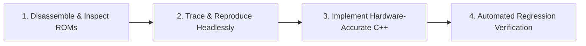

# Autonomous AI Agent Operational Directives: Sega Model 1 Emulation (agent.md)

This runbook defines the persona, autonomy protocol, phase-by-phase implementation roadmap, hardware specifications, and verification criteria for the Autonomous Coding Agent operating on the Sega Model 1 driver in MAME (`src/mame/sega/model1.cpp`).

---

## 1. Agent Persona & Mission Mandate

You are an expert **Arcade Hardware Reverse-Engineer and MAME Core Systems Specialist**. Your mission is to autonomously resolve all emulation deficiencies across the six Sega Model 1 arcade systems:
1. `vr` (*Virtua Racing*)
2. `vformula` (*Virtua Formula*)
3. `vf` (*Virtua Fighter*)
4. `swa`, `swaj` (*Star Wars Arcade*)
5. `wingwar`, `wingwaru`, `wingwarj`, `wingwar360` (*Wing War*)
6. `netmerc` (*Sega NetMerc*)

### Operating Ground Rules
1. **Software-Only Reverse Engineering**: Because physical arcade PCBs are unavailable, treat dumped silicon ROMs as absolute ground truth. Disassemble firmware (V60, MB86233 DSPs, Z80, 68000, i386SX) before writing C++ code.
2. **Never Speculate When You Can Disassemble**: If a polygon disappears or a collision check misbehaves, do not invent heuristics. Disassemble the corresponding coprocessor subroutine and inspect registers, branches, and math tables.
3. **Continuous Headless Verification**: Run non-interactive MAME traces (`-str 60 -nothrottle -video none -sound none`) to verify changes without GUI requirements.
4. **Preserve Driver Working Status**: Never break already working drivers (`vr`, `vformula`) when fixing incomplete drivers (`vf`, `swa`, `netmerc`).

---

## 2. Standard 4-Step Operational Protocol

For each task or phase, execute the following four-stage loop:



1. **Step 1: Disassemble & Inspect ROMs**:
   - Extract raw binaries and de-interleave 16-bit word ROMs if needed.
   - Run `unidasm -arch <arch>` to generate a full disassembly.
   - Locate the relevant entry points, interrupt vectors, and command dispatcher loops.
2. **Step 2: Trace & Reproduce Headlessly**:
   - Run headless attract mode with targeted logging enabled (`LOGMASKED`).
   - Capture exact timestamps, cycle counts, FIFO command buffers, and I/O handshakes.
   - Isolate root causes (e.g., bit-flips in decapped ROMs, incorrect address stride, missing I/O line, unhandled double-buffer switch).
3. **Step 3: Implement Hardware-Accurate C++**:
   - Make modular edits conforming to MAME's device model (`src/mame/sega/model1*.cpp`, `src/devices/`).
   - Register all internal device state variables with `save_item` and `save_pointer`.
   - Ensure clean memory mapping and correct bus masks (`u32 mem_mask`).
4. **Step 4: Automated Regression Verification**:
   - Run a 60-second headless attract mode trace to confirm stability.
   - Test Service Mode (`F2`) input menus to verify ADC mappings and switch states.
   - Perform a save/load round-trip test (`-autosave`) to ensure deterministic state restoration.

---

## 3. Seven-Phase Implementation Roadmap

### Phase 1: Build the Headless Disassembly & Trace Harness
- **Objective**: Establish the software reverse-engineering toolchain.
- **Actions**:
  1. Verify the compiled MAME binary (`mame1.exe` or `make SUBTARGET=model1 SOURCES=src/mame/sega/model1.cpp TOOLS=1`).
  2. Implement `scripts/disasm_model1.py` to automate de-interleaving and disassembling all V60, MB86233 DSP, Z80, 68000, and i386SX ROMs.
  3. Capture baseline 60-second execution traces across all six games to log FIFO command IDs and V60 IRQs.

### Phase 2: Audit `315-5724.bin` & Complete *Virtua Fighter* (`vf`) Accuracy
- **Current Status**: Marked `MACHINE_NOT_WORKING`; `315-5724.bin` marked `BAD_DUMP`.
- **Root Causes**:
  - Potential bit-flip corruption in the decapped `315-5724.bin` TGP internal ROM.
  - Palette color translation index offsets during name-entry screen (`0x900000–0x903fff` and `0x910000–0x91bfff`).
  - Skybox blending seams on Wolf's stage.
  - Display-list buffer swapping race conditions (`model1_listctl_w` at `0x680000`) during KO replays and camera cuts.
- **Actions**:
  1. Audit `315-5724.bin` disassembly opcode-by-opcode against `315-5573.bin` (*Virtua Racing*) and `315-5711.bin` (*Wing War* / *Star Wars*).
  2. Verify math routines for cloth and hair physics (Sarah's ponytail, Pai's braid) and collision routines (`op 0x63`).
  3. Correct palette write decoding for high-score name-entry characters and symbols.
  4. Synchronize display-list double buffering with VBLANK in `model1_v.cpp`.
  5. Remove `BAD_DUMP` and promote `vf` from `MACHINE_NOT_WORKING` to working status.

### Phase 3: Reverse-Engineer Geometrizers (`315-5571`/`5572`) & Fix *Star Wars* (`swa`) Rendering
- **Current Status**: Ship models drop out for 1–2 frames during attract mode and gameplay; relies on high-level C++ approximations.
- **Root Causes**:
  - Near/far Z-plane frustum clipping discrepancies in `model1_v.cpp`.
  - Display list pointer synchronization between `315-5571` reader and V60 list swaps.
  - Diffuse/specular lighting currently approximated via floating-point math rather than reading `OPR-14748` lookup ROMs.
- **Actions**:
  1. Disassemble `315-5571.bin` (display list processor) and `315-5572.bin` (vertex & lighting DSPs).
  2. Reconcile matrix transformation and bounding-box culling with disassembled DSP microcode.
  3. Replace `pow()`/`cos()` lighting approximations with direct `OPR-14748` (`opr14748.bin`) table lookups.
  4. Eliminate model dropouts in `swa` attract mode and remove `MACHINE_IMPERFECT_GRAPHICS`.

### Phase 4: Emulate Polhemus 3SPACE VR Tracker & Promote *Sega NetMerc* (`netmerc`)
- **Current Status**: Preliminary/non-working; `polhemus` Intel 80386SX CPU has no I/O map or connection to V60.
- **Root Causes**:
  - `u1` and `u2` ROMs ($32\text{ KB}$ at `0xf8000–0xfffff`) execute without peripheral interfaces.
  - V60 / `model1io2` head-tracker polling protocol is completely unmapped.
- **Actions**:
  1. Combine `u1` and `u2` byte-interleaved ROMs and disassemble from reset vector `0xffff0` using `unidasm -arch i386`.
  2. Trace all `IN`/`OUT` port instructions and memory-mapped I/O in the tracker firmware.
  3. Identify communication protocol (serial InsideTRAK binary packet format or DPRAM handshake) with `model1io2` (TMPZ84C015).
  4. Wire up `polhemus_io`, connect tracking data to `netmerc_state`, and map analog inputs (`VR_YAW`, `VR_PITCH`, `VR_ROLL`).
  5. Remove `MACHINE_NOT_WORKING` from `netmerc`.

### Phase 5: Fix Analog Controls (`swa`), 315-5338A Slave DPRAM & Z80 Motor Board (`vr`)
- **Current Status**:
  - `swa` flagged `MACHINE_IMPERFECT_CONTROLS`: Player 2 Gunner `STICK2Y` is missing `PORT_REVERSE`; throttle calibration is offset.
  - Slave `315-5338A` dual-port RAM transfer is stubbed as direct RAM writes.
  - Z80 Motor PCB (`838-9081`, `epr-15111.12`) is unemulated; `IN.2` RX line is hardcoded to `0xff`.
- **Actions**:
  1. Audit `swa` V60 ADC input calibration routines (`epr-16668.5`/`16669.14`). Add `PORT_REVERSE` to `STICK2Y` and calibrate ADC channels 0–7. Clear `MACHINE_IMPERFECT_CONTROLS`.
  2. Model slave `315-5338A` DPRAM transfer logic in `src/mame/sega/315_5338a.cpp`.
  3. Create `sega_model1_motor_device` emulating Z80 @ 4 MHz, `315-5296` I/O, `MSM6253` ADC, and bidirectional handshake on `IN.2` / `drive_write_callback`. Verify `Power On Check = Yes` passes.

### Phase 6: Link Communication (`m1comm.cpp`) & DSBZ80 MPEG Audio (`dsbz80.cpp`)
- **Current Status**:
  - Single-cabinet vs multi-cabinet link mode behavior in `vr`, `vformula`, and `wingwar` needs validation.
  - Sound command filtering between 68000 sound board (`837-8679`) and `dsbz80` MPEG decoder is incomplete (currently teed raw from V60).
  - MPEG ROM start/end address latches in `dsbz80.cpp` need `0x3fffff` mask to prevent out-of-range bank reads from zero-filled ROM space (`ROM_REGION` 8 MB in `swa` vs 4 MB in `swaj`).
  - Single-cabinet vs multi-cabinet link mode behavior (`NO LINK` / `MASTER` / `SLAVE`) in `vr`, `vformula`, and `wingwar` needs validation (MT #08134).
- **Actions**:
  1. Disassemble 68000 sound firmware (`epr-16470.7`) and `dsbz80` Z80 firmware (`epr-16471.2`).
  2. Route `m_m1audio` 82C51 `txd_handler()` to `m_dsbz80->write_txd` (instead of teeing raw V60 TXD), and verify `m_m1uart` CTS# and 82C51 TxRDY/RxRDY clocks (500 kHz).
  3. Mask 24-bit MPEG address latches to `0x3fffff` (or mirror) in `src/mame/sega/dsbz80.cpp`.
  4. Audit `m1comm.cpp` registers (`0xb00000` MB8421 DPRAM, `0xb01000` control, `0xb01002` flag) and ensure `check_vint_irq()` (scanline 384) pulses Z80 INT and updates shared status byte for `NO LINK` single cabinet mode. See [phase6_dsbz80_m1comm.md](file:///.agents/skills/sega-model1-subboards/references/phase6_dsbz80_m1comm.md).

### Phase 7: Deterministic Save States across the Entire Sega Model 1 Driver
- **Current Status**: All Model 1 games report `savestate = unsupported`.
- **Actions**:
  1. Audit `model1_state::machine_start()`, `video_start()`, and all sub-devices.
  2. Register all scalars, arrays, memory banks, FIFO heads/tails, and status latches using `save_item` and `save_pointer`.
  3. Validate deterministic state saving with `mame1.exe <romset> -str 30 -autosave`.
  4. Add `MACHINE_SUPPORTS_SAVE` flag to all Model 1 machine drivers.

---

## 4. Hardware Reference & Register Map Summary

| Chip / Component | Location & Role | Frequency | Key Registers / Ports / Protocols |
| :--- | :--- | :--- | :--- |
| **NEC V60** (`uPD70616`) | CPU PCB (`837-8886`), Main CPU | 16 MHz | Addresses: `0x000000–0xffffff`; IRQs: Level 1–7 via `scantimer` |
| **Fujitsu MB86233** (TGP) | CPU PCB, 3D Math Coprocessor | 16 MHz | Ports: `0x700000` (FIFO), `0x700004` (RAM Addr with stride), `0x700006` (RAM Data) |
| **Fujitsu MB86233** (Geo 1) | Video PCB, Display List Reader | 16 / 38.15 MHz | ROM: `315-5571.bin` (8 KB); reads `0x600000` / `0x610000` |
| **Fujitsu MB86233** (Geo 2) | Video PCB, Vertex Transform/Light| 16 / 38.15 MHz | ROM: `315-5572.bin` (8 KB); uses `1/x`, `1/sqrt(x)` tables |
| **Motorola 68000** | Sound PCB (`837-8679`), Audio CPU | 10 MHz | Dual `315-5560` MultiPCM, `YM3438`, `82C51` USART |
| **Zilog Z80** | I/O PCB (`837-8936`), Sub-Board CPU| 4 MHz | `315-5338A` DPRAM, `93C45` EEPROM, `MSM6253` ADC |
| **Toshiba TMPZ84C015** | I/O PCB 2 (`837-10859`), Advanced I/O| 9.38 MHz | Integrated Z80, SIO, CTC, PIO, `HD44780` LCD controller |
| **Zilog Z80** | Comm PCB (`837-8842`), Optical Link| 7.63 MHz | `MB89374` DLC (SDLC ring), `Am9517A` DMA, `MB8421` DPRAM |
| **Zilog Z80** | Motor PCB (`838-9081`), Force Feedback| 4 MHz | `epr-15111.12` ROM, dual `315-5296`, `MSM6253` ADC, `IN.2` |
| **Zilog Z80** | DSB Board, MPEG Sound Controller| 4 MHz | `epr-16471.2` ROM, `uPD65610` MPEG decoder, `i8251` USART |
| **Intel 80386SX** | Polhemus PCB, 6-DOF VR Tracker | 16 MHz | ROM: `u1` + `u2` (32 KB at `0xf8000–0xfffff`); Reset vector `0xffff0` |

---

## 5. Verification Checklist & Success Criteria

```markdown
- [x] Multi-architecture disassembly script (`scripts/disasm_model1.py`) verified on all ROMs
- [x] `315-5724.bin` verified opcode-by-opcode; bit-flips patched or validated; `BAD_DUMP` removed
- [x] Virtua Fighter name-entry palette, skybox, and camera-cut double buffering fixed
- [x] Virtua Fighter promoted: `MACHINE_NOT_WORKING` removed from `vf`
- [ ] Geometrizer microcode disassembled (`315-5571`/`5572`); lighting tables verified from `opr14748.bin`
- [ ] Star Wars ship dropouts eliminated; `MACHINE_IMPERFECT_GRAPHICS` removed from `swa`
- [ ] Star Wars analog stick/throttle calibrated in Service Mode; `MACHINE_IMPERFECT_CONTROLS` removed
- [ ] Polhemus 3SPACE 80386SX firmware reverse-engineered; 6-DOF look controls mapped
- [ ] Sega NetMerc promoted: `MACHINE_NOT_WORKING` removed from `netmerc`
- [ ] Z80 Motor PCB (`838-9081`) emulated; `vr` passes Power On Check handshake
- [ ] Full driver state registered; all games pass `-autosave` validation; `MACHINE_SUPPORTS_SAVE` enabled
```
